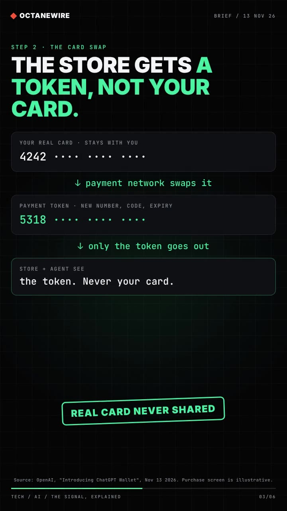

# ChatGPT Wallet: your AI agent can pay now, and it never sees your card

*How OpenAI's new agent wallet works, who can use it today, what's still missing, and a checklist before you let any agent spend your money.*

On November 13, 2026, OpenAI launched ChatGPT Wallet. In OpenAI's words, it's "the first wallet that lets agents pay without access to users' actual card details and that requires a security check for every purchase." It was built with American Express, Mastercard and Visa.

## How a purchase works

1. **You add a card once.** After that you don't re-enter payment details.
2. **The agent prepares the purchase.** In ChatGPT these agents are called dots.
3. **You review it.** Items, total and the card it will charge.
4. **You approve with a security check,** such as Face ID or a fingerprint. Every approval creates a record of exactly what you authorized.
5. **The card swap.** The payment network issues a payment token: a substitute card number, security code and expiry date. The store gets the token. Neither the store nor the agent ever gets your real card details.

## What you keep

- **Your card rewards.**
- **Dispute protection** for eligible disputes, for example a defective item.
- **A direct relationship with the store.** The business keeps control of pricing, delivery, returns and customer service.

## Who can use it today

- ChatGPT **Pro** subscribers in the **US**, aged **18+**, with eligible **US-issued cards**.
- It works inside dots. OpenAI calls it a limited, gradual rollout.

## What's not there yet

- **Spending limits, category rules and time windows.** OpenAI says that "over time" users should be able to set those and pre-approve purchases. Today you approve each purchase yourself.
- **Every store.** OpenAI says some sites may unintentionally block agent purchases while they adapt. It published a Commerce Partner Playbook for businesses and is working with fraud-prevention companies (Forter, Riskified, Sardine, Signifyd) and payment providers (Adyen, Checkout.com, Stripe).

## Why it matters

1.2 billion people use ChatGPT every week, according to OpenAI. Many already use it to research and compare products. Until now the agent stopped at the checkout. This is the first big wallet designed so the agent can finish the job without holding your card.

## Checklist before you let any agent spend money

- [ ] **Every purchase needs your tap.** ChatGPT Wallet does this by default. Keep it that way for any agent you use.
- [ ] **Check the total and the card,** not just the item. Shipping and add-ons hide in the total.
- [ ] **Use a credit card, not debit,** so disputes don't freeze your own cash.
- [ ] **Read the record afterwards.** Every approval is logged. Glance at it weekly.
- [ ] **Never paste card numbers into a chat** with any AI. A real agent wallet never asks for that.
- [ ] **Watch for fake "agent checkout" pages.** If a link asks for your full card details to "connect your agent", close it.

## For businesses

If you sell online, read OpenAI's Commerce Partner Playbook. The short version: don't let your firewall block legitimate agents, keep product info accurate, and talk to your payment and fraud providers so agent purchases aren't declined.

## Your turn

Would you let an agent buy for you? Reply on the [OctaneWire post](https://x.com/OctaneWire).

---

**Sources**

- OpenAI: [Introducing ChatGPT Wallet](https://openai.com/index/introducing-chatgpt-wallet/) (Nov 13, 2026). All quotes and figures are from this page.
- OpenAI Help Center: [Making purchases with ChatGPT Wallet](https://help.openai.com/en/articles/20001654-making-purchases-with-chatgpt-wallet)

*Written by [OctaneWire](https://x.com/OctaneWire). Tech, AI, markets. The signal, explained.*
