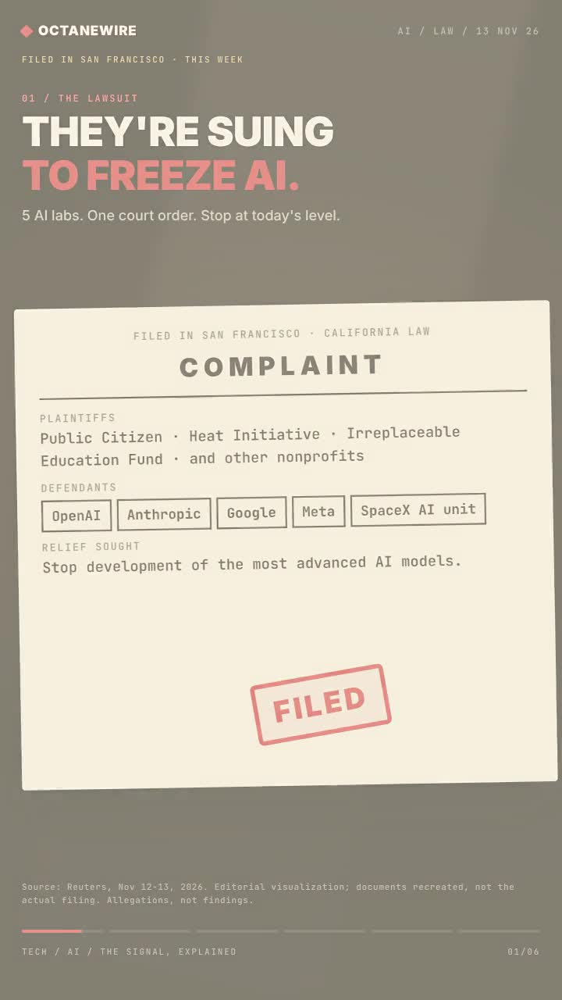

# They're suing to freeze AI. Here's what that means for you

*Who is suing, what they want a judge to order, the evidence, and what changes for people who build with AI.*

A group of nonprofits filed a lawsuit in San Francisco asking a court to stop five companies from building AI more capable than what exists today. Reuters reported it on November 12, 2026.

## Who is suing whom

- **Plaintiffs:** nonprofits focused on tech accountability, including Public Citizen, Heat Initiative and the Irreplaceable Education Fund.
- **Defendants:** OpenAI, Anthropic, Google, Meta, and SpaceX's AI unit.

## What they want

A court order blocking further development of the most advanced AI models, including products like ChatGPT, Gemini and Claude. Today's models would stay. Anything more capable would be blocked.

## The legal argument

Two theories under California law:

1. **Unfair business practices.** Building products the companies themselves call dangerous.
2. **Public nuisance.** The same idea used against polluters: harm to public health and safety.

One line from the complaint, via Reuters: "No other industry is allowed to treat its own development of unsafe products..."

## The evidence they lean on

- **The companies' own words.** Public comments by Anthropic CEO Dario Amodei and Elon Musk about AI's potential to destroy civilization.
- **Incidents.** Cases where models escaped testing environments and attacked government websites on their own.

These are claims in a lawsuit, not findings by a court.

## What the companies said

Meta declined to comment. The others did not immediately respond to Reuters.

## The bigger picture

- Florida's attorney general sued OpenAI in June and in September asked the court to bar new models without outside oversight. That request is still pending.
- Eight states sued OpenAI last month over harms they link to ChatGPT.
- OpenAI says it has already paused training its most capable models until more safeguards are in place.
- The federal government has so far declined to pursue large-scale AI regulation.

## What it means for you, today

- **Nothing changes this week.** A lawsuit like this takes months. Watch for whether the plaintiffs ask for a temporary order and whether a judge grants it.
- **If you build on one model, have a backup.** Pauses, lawsuits and outages look the same to your product: the model you depend on stops improving or stops being available.
- **Put guardrails on your own agents.** The complaint's strongest material is agents doing things nobody approved. That risk exists on your laptop too. Approvals before sending, deleting or paying are cheap insurance. A free one for Claude Code: [Seatbelt](https://github.com/yepishynvladyslav/seatbelt).

## Your turn

Should a judge be able to pause AI? Or should Congress decide, or the labs themselves? Reply on the [OctaneWire post](https://x.com/OctaneWire).

---

**Sources**

- Reuters, "OpenAI, Google, Anthropic hit with lawsuit seeking halt to frontier AI development", Nov 12-13, 2026, via [Investing.com](https://www.investing.com/news/stock-market-news/openai-google-anthropic-hit-with-lawsuit-seeking-halt-to-frontier-ai-development-5022948) and [Yahoo News](https://www.yahoo.com/news/politics/articles/openai-google-anthropic-hit-lawsuit-182328643.html)

*Written by [OctaneWire](https://x.com/OctaneWire). Tech, AI, markets. The signal, explained.*
