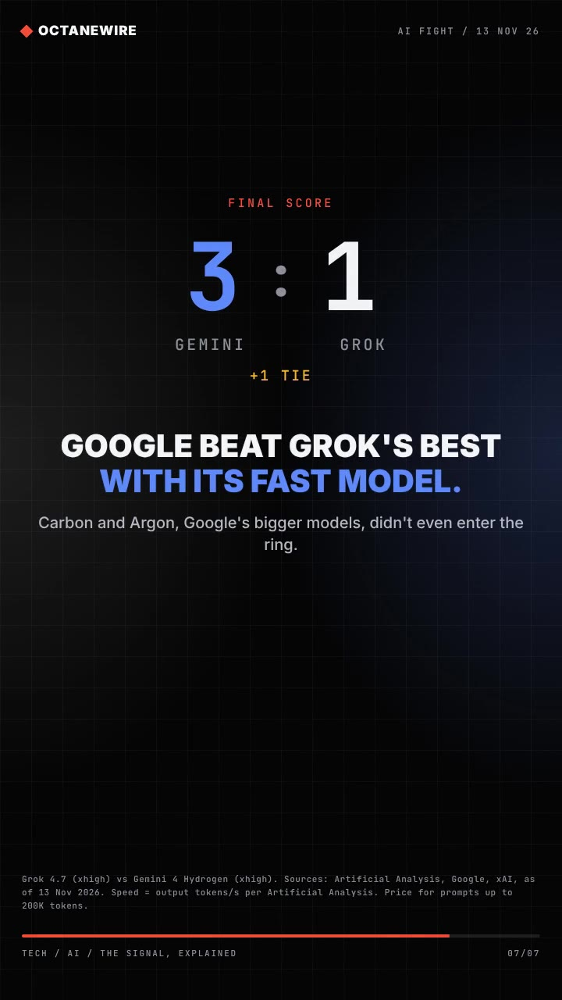

# Gemini 4 Hydrogen vs Grok 4.7: the scorecard

*Google's new fast model against xAI's flagship. Five rounds, each one sourced. Which to use for what.*

Google released Gemini 4 Hydrogen on November 12, 2026. It replaces Gemini 3.8 Flash, so it's Google's fast, everyday model. The bigger Gemini 4 Carbon and Argon sit above it. Grok 4.7, released September 21, is xAI's most capable model.

So this is Google's mid-tier model against xAI's best one. Here's how it went.

## The scorecard

| Round | Grok 4.7 | Gemini 4 Hydrogen | Winner |
|---|---|---|---|
| Intelligence (Artificial Analysis Intelligence Index, xhigh) | 46 | 54 | Gemini |
| Hallucination rate (AA-Omniscience, lower is better) | 29% | 8% | Gemini |
| Output speed (tokens per second, Artificial Analysis) | ~188 | 185 | Tie |
| Price per 1M output tokens (prompts up to 200K) | $6.00 | $7.50 | Grok |
| Context window | 500K | 1M | Gemini |

**Final: Gemini 3, Grok 1, one tie.**

## Where Grok still wins

- **Output price.** $6 per million output tokens against $7.50. Answers cost about 20% less on Grok. Input is the other way round: $2 for Grok, $1.50 for Hydrogen.
- **Work tasks, on xAI's own numbers.** Grok 4.7 scores 1695 Elo on GDPval-AA and 19.6% on the Harvey Legal Agent Benchmark, ahead of several frontier models in xAI's table. Google hasn't published Hydrogen numbers on these, so there's no head-to-head yet.
- **Grok Bot.** xAI says Grok 4.7 was trained to natively understand the Grok Bot harness, the agents that join your meetings and work in your tools. If you live in that setup, the model fit matters more than an index score. (Our guide: [Grok Bot is the coworker you can actually hand work to](grok-bot-coworker-guide.md).)

## Where Gemini wins

- **It's smarter on the independent index.** 54 against 46 at the highest reasoning setting. Even at its default level, Hydrogen scores 51.
- **It makes far fewer things up.** 8% hallucination rate against 29%.
- **Twice the memory.** 1M tokens in, up to 1M out, at one flat price across the whole window. Grok's price doubles above 200K-token prompts.
- **It's everywhere.** Gemini app, Google Search for all users, Sheets, the API and AI Studio.

## The catch on both

- Hydrogen's top setting (xhigh) nearly doubles its output tokens, so a task costs about $3.16 at xhigh against $1.87 at high, per Artificial Analysis.
- Grok 4.7 uses about 81K output tokens per index task, more than double Grok 4.6.
- These are benchmark numbers. Run your own five real prompts on both before you switch anything.

## Which one to use

- **Long documents, codebases, research, anything where wrong facts hurt:** Hydrogen.
- **High-volume output where cost per answer matters, or you already run Grok Bot:** Grok 4.7.
- **Waiting game:** Grok 5 isn't out yet. This scorecard is what it has to beat.

## Your turn

Would you switch, or wait for Grok 5? Reply on the [OctaneWire post](https://x.com/OctaneWire).

---

**Sources**

- Google: [Introducing Gemini 4 Hydrogen](https://blog.google/innovation-and-ai/models-and-research/gemini-models/introducing-gemini-4-hydrogen/) (release, pricing, context, thinking levels)
- xAI: [Grok 4.7](https://x.ai/news/grok-4-7) (release, pricing, GDPval, Harvey Legal, Grok Bot)
- Artificial Analysis: [Benchmarking Grok 4.7](https://artificialanalysis.ai/articles/benchmarking-grok-4-7) (index 46, hallucination 29%, ~188 tokens/s) · [Gemini 4 Hydrogen](https://artificialanalysis.ai/models/gemini-4-hydrogen) (index 54, 185 tokens/s, $3.16 per task)
- The Decoder: [Gemini 4 Hydrogen outscores the bigger Argon](https://the-decoder.com/googles-gemini-4-hydrogen-outscores-the-bigger-argon-just-four-weeks-after-its-launch/) (Artificial Analysis hallucination rate 8%, index 51 at high)
- VentureBeat: [Gemini 4 Hydrogen launch](https://venturebeat.com/technology/google-launches-gemini-4-hydrogen-a-faster-smarter-pricier-flash-successor) (Grok 4.7 price tiers above 200K)

*Numbers as of November 13, 2026. Written by [OctaneWire](https://x.com/OctaneWire). Tech, AI, markets. The signal, explained.*
