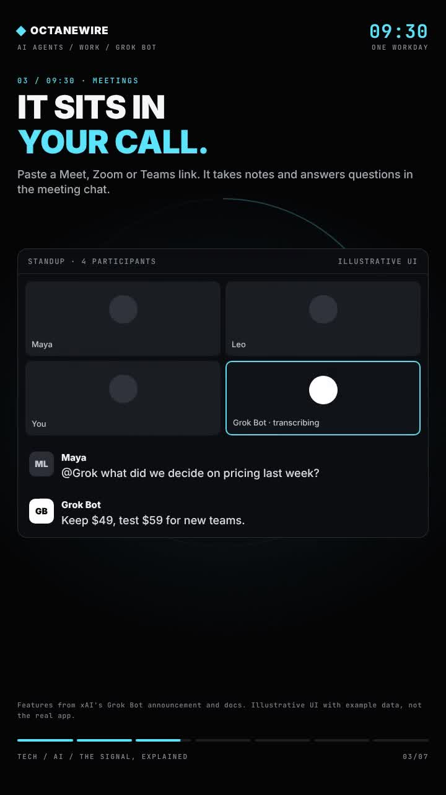
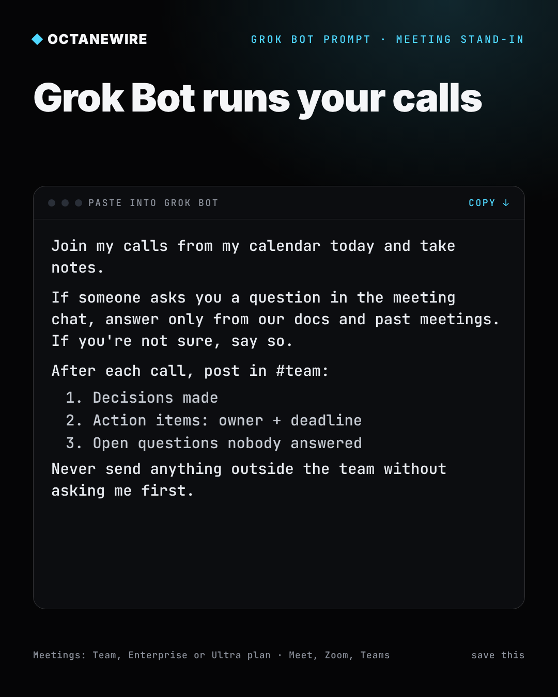
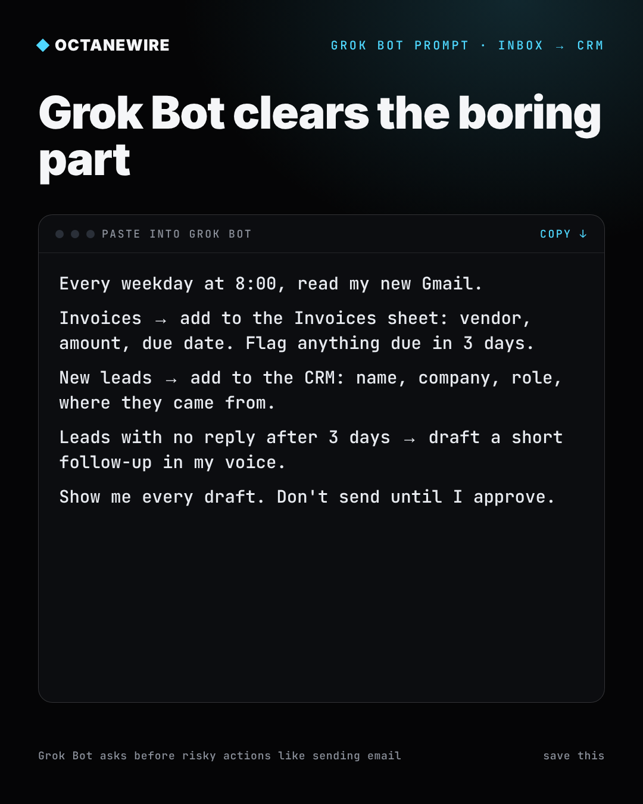
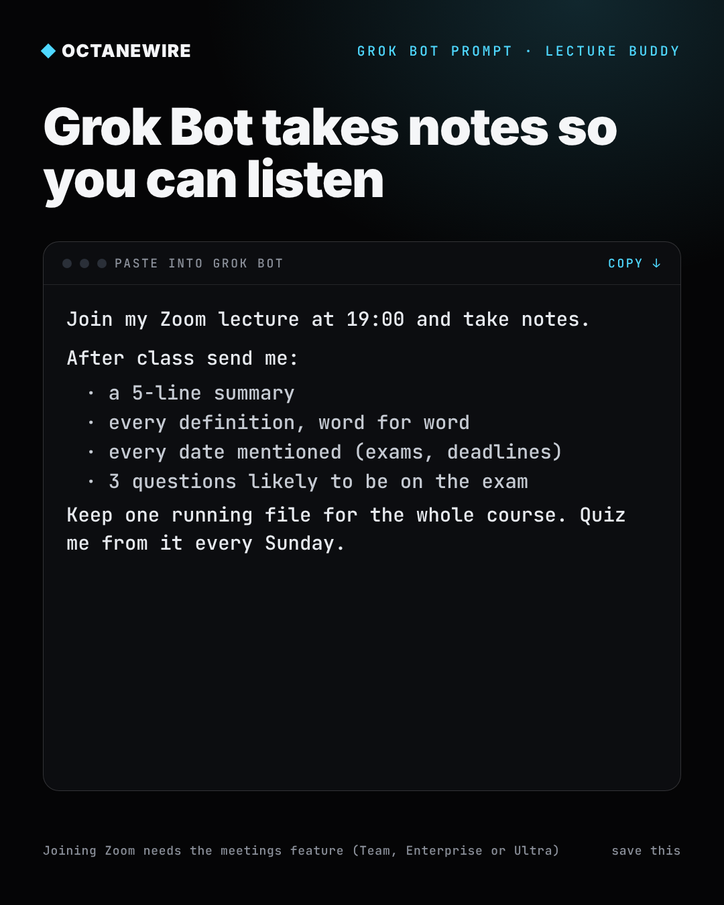

# Grok Bot is the coworker you can actually hand work to

*What it does at work, three copy-paste prompts, what it costs, and where it breaks.*



Most AI tools wait for you to type. Grok Bot is built the other way round. xAI calls it "your team of always-on agents": each bot gets its own computer, works inside the same tools and websites you do, and comes back to you only when something needs your approval.

## What it actually does

- **Meetings.** Paste a Google Meet, Zoom or Microsoft Teams link into your chat with the bot, or let it follow your calendar. The host admits it like a guest. It takes notes, answers questions people ask it in the meeting chat, and posts a summary with action items when the call ends.
- **Your team's chat.** A Team Bot can be shared with the whole company in Slack or Microsoft Teams. Anyone can mention it in a channel.
- **The boring work.** xAI's own examples: processing invoices from Gmail, CRM updates and follow-ups, outbound research with drafted emails, reproducing bugs and filing tickets, a Monday pipeline scoreboard.
- **Routines.** Jobs that run on their own once set up.

## The part that makes it usable: it asks first

Before a risky action, it asks the person it is working for. In a Slack thread only the person who asked can approve. When a Team Bot learns something new, the change waits for the owner or a manager to approve it.

## Prompt 1: meeting stand-in



```
Join my calls from my calendar today and take notes.
If someone asks you a question in the meeting chat, answer only from our docs and past meetings. If you're not sure, say so.
After each call, post in #team:
1. Decisions made
2. Action items: owner + deadline
3. Open questions nobody answered
Never send anything outside the team without asking me first.
```

## Prompt 2: inbox → CRM



```
Every weekday at 8:00, read my new Gmail.
Invoices → add to the Invoices sheet: vendor, amount, due date. Flag anything due in 3 days.
New leads → add to the CRM: name, company, role, where they came from.
Leads with no reply after 3 days → draft a short follow-up in my voice.
Show me every draft. Don't send until I approve.
```

## Prompt 3: lecture buddy



```
Join my Zoom lecture at 19:00 and take notes.
After class send me: a 5-line summary, every definition word for word, every date mentioned (exams, deadlines), and 3 questions likely to be on the exam.
Keep one running file for the whole course. Quiz me from it every Sunday.
```

## What it costs and where it breaks

- Meetings need a Team, Enterprise or Ultra plan. Team Bots need Team or Enterprise.
- Bot usage is billed separately from your Grok plan. Plans reportedly run $30, $100 and $200 a month, with extra usage on top.
- Elon Musk has said xAI is working on making it use tokens more efficiently.
- Each bot runs on a cloud computer in the US. Check that before you connect company data.

## Bottom line

Try Grok Bot for one job you hate, not for everything at once. Start with meetings. Approve every action for the first week. Then hand it the inbox.

---

**Sources**

- xAI: [Introducing Grok Bot](https://x.ai/news/introducing-grok-bot) · [Grok Bot on more plans](https://x.ai/news/grok-bot-more-plans)
- xAI docs: [Team Bots](https://docs.x.ai/grok-bot/team-bots) · [Meetings](https://docs.x.ai/grok-bot/meetings)
- [DataNorth: Grok Bot 1.0 for Slack and Teams](https://datanorth.ai/news/grok-bot-1-0-slack-teams) (plans and pricing as reported)
- [TokenPost: Musk on Grok Bot token use](https://www.tokenpost.com/news/technology/52427)

*Written by [OctaneWire](https://x.com/OctaneWire). Tech, AI, markets. The signal, explained.*
