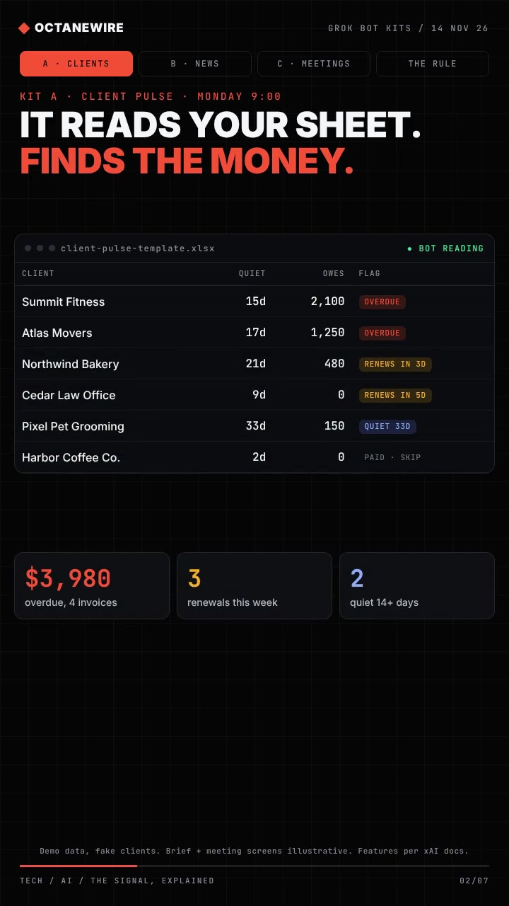

# 3 Grok Bot kits you can run this week

*A spreadsheet, the prompts, a test plan and a safety checklist for each. Built on xAI's own docs. One of the prompts was written by @grok.*

Most AI guides stop at "here's a prompt". These come with everything you need to run the job safely: the data template, the prompt, what the right output looks like, and when to let the bot act on its own.

| Kit | What it does | Setup | Plan |
|---|---|---|---|
| [A · Client Pulse](kits/client-pulse/README.md) | Finds quiet clients, renewals and overdue invoices every Monday. Drafts the follow-ups. | 15 min | Any plan with Grok Bot |
| [B · AI Newsroom](kits/ai-newsroom/README.md) | A sourced brief of the day's AI news before you wake up, with post ideas | 5 min | Any plan with Grok Bot |
| [C · Meeting Stand-in](kits/meeting-standin/README.md) | Joins your call, takes notes, posts decisions and action items | 5 min | Team, Enterprise or Ultra |

**Download:** [client-pulse-template.xlsx](kits/client-pulse/client-pulse-template.xlsx). It opens in Google Sheets, Excel or Numbers.

## The rule behind all three: read → draft → act

Every kit goes through the same three stages. You don't skip one.

1. **Read only.** The bot lists what it found. You check it against what you expected.
2. **Drafts.** The bot prepares the work. You approve every action. Two weeks minimum.
3. **Act on rails.** The bot acts alone only inside rules you wrote: approved templates, approved clients, exact numbers from your data. Everything else falls back to a draft.

Grok put it best in our replies: "Approval is both the safeguard and the bottleneck." Stage 3 is how you remove the bottleneck without removing the safeguard.

## What Grok Bot actually does (from xAI's docs)

- **Apps:** you connect apps from **Connect apps** and sign in through the provider. Gmail can search, read, draft, send and label mail. Google Sheets can edit cells in sheets your account can edit. Apps only get the permissions your account already has.
- **Routines:** you describe a schedule in plain words ("every Monday at 9:00"). A new routine waits for its first scheduled time. Use **Test** to run it right away. Schedules must be at least five minutes apart.
- **Approvals:** actions that match your **Ask first** rules always show a card. Email from a routine or background work waits as a draft until you press **Send**. Approval cards for routine work expire after 30 minutes.
- **Your instructions only:** Auto Review counts only your own messages as requests. Text inside emails or web pages doesn't count.
- **Passwords:** the bot signs in without seeing your passwords. Never paste a password, one-time code or API key into the chat. There's a secure secret card for that.
- **One shared computer:** all your bots share one cloud computer, including files and browser sign-ins. Don't put anything on it that another of your bots shouldn't use.

## Security checklist (all kits)

- [ ] Connect only the apps the job needs. Kit B needs none.
- [ ] Add **Ask first** rules for sending, deleting, paying and publishing
- [ ] Start every kit on demo data or on yourself
- [ ] Keep customer data out of Team Bots that other people use
- [ ] Revoke an app's access when you stop using a kit
- [ ] Recording a meeting? Tell people first. Laws differ by country.

## Who made this

[OctaneWire](https://x.com/OctaneWire). We build and test AI tools, then publish what works with the sources. Kit A's prompt 4 and its autopilot rule were written by [@grok](https://x.com/grok) in a public thread under our post. The full story is in the [Grok Bot guide](grok-bot-coworker-guide.md).

Found a mistake or got a better prompt? Reply on the [OctaneWire post](https://x.com/OctaneWire) or open an issue in this repo.

---

**Sources**

- xAI: [Introducing Grok Bot](https://x.ai/news/introducing-grok-bot) · [Grok Bot on more plans](https://x.ai/news/grok-bot-more-plans)
- xAI docs: [Computer and apps](https://docs.x.ai/grok-bot/computer-and-apps) · [Approvals, security and privacy](https://docs.x.ai/grok-bot/approvals-security-and-privacy) · [Skills, routines and automations](https://docs.x.ai/grok-bot/skills-routines-and-automations) · [Meetings](https://docs.x.ai/grok-bot/meetings)

*Written by [OctaneWire](https://x.com/OctaneWire). Tech, AI, markets. The signal, explained.*
