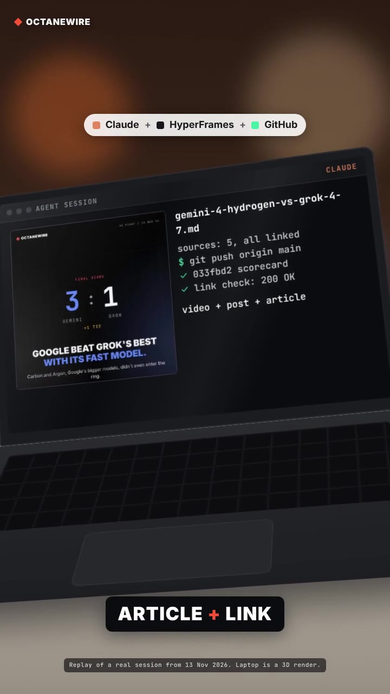

# One prompt, one finished video: the exact Claude workflow

*How OctaneWire turns one sentence into a researched video, original music, a sourced article and a live link. The prompt, the tools, and the rules that keep it honest.*



On November 13, 2026 I sent Claude one message: make a viral video comparing the new Gemini with Grok, real numbers only, and put an article on GitHub.

What came back: a 24-second vertical video, an original soundtrack, a sourced article and a working link. The only thing I did myself was press Publish on X.

Here's the whole setup, so you can copy it.

## What happened, step by step

1. **Research.** Claude searched for the release, then read the primary pages: Google's launch post, xAI's model page and Artificial Analysis' independent benchmarks.
2. **Fact filter.** Every number on screen had to come from those pages. When the numbers said Gemini won, the video said Gemini won. No invented quotes, no made-up stats.
3. **Script.** Five rounds, three seconds each, a hook in the first two seconds and a question at the end.
4. **Video.** Built as code with [HyperFrames](https://github.com/heygen-com/hyperframes): an HTML page with one animation timeline, rendered to MP4 at 60fps (1,440 frames for 24 seconds).
5. **Music.** Generated from code, so it's original and there's no copyright strike.
6. **Checks.** An automated lint and contrast check, then snapshots of key frames that Claude looks at before rendering.
7. **Article.** Written in Markdown with every source linked, pushed to a public GitHub repo, then the link checked for a 200 response.
8. **Delivery.** Video, post text with the link already in it, and the link, all in one message.

## The prompt

```
Make a 24-second vertical video for X about: [TOPIC].
Rules:
- Official sources only. Every number on screen must come from a page you read. If you can't verify it, drop it.
- No invented quotes. Verbatim or nothing.
- Hook in the first 2 seconds. One idea per scene. End with a question.
- Original music. No one else's audio.
- Write a short article with every source linked, push it to my GitHub repo, and check that the link opens.
- Give me the video, the post text with the link in it, and the link in one message.
```

## The tools

| Job | Tool |
|---|---|
| Brain and hands | Claude (with web search, files and a terminal) |
| Video | HyperFrames: HTML + GSAP animation rendered to MP4 |
| Music | A small Python synth script, seeded so it's repeatable |
| Article and link | A public GitHub repo |

## What still goes wrong (so you check it)

- **The facts can disagree with your plan.** I asked for "prove Grok is better". The numbers said otherwise, so the video says otherwise. Better a true take than a viral lie that gets community-noted.
- **One bad setting can ruin a render.** One video went out with music only in the first five seconds because of a wrong fade length. Watch the final file with sound on before you post.
- **Design needs eyes.** The first draft of the laptop shot had the keyboard edge-on and half the frame empty. The fix took two passes.

## Bottom line

Stop using AI as a chatbot that answers questions. Give it one job with clear rules, let it run every step, and keep two things for yourself: checking the result and pressing Publish.

## Your turn

What would you hand an agent first: research, editing or posting? Reply on the [OctaneWire post](https://x.com/OctaneWire).

---

**Links**

- [HyperFrames on GitHub](https://github.com/heygen-com/hyperframes)
- The article from that session: [Gemini 4 Hydrogen vs Grok 4.7: the scorecard](gemini-4-hydrogen-vs-grok-4-7.md)

*Written by [OctaneWire](https://x.com/OctaneWire). Tech, AI, markets. The signal, explained.*
