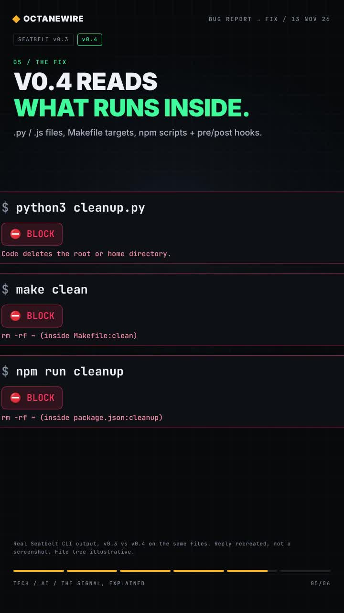

# How to stop your AI agent from deleting your files (free, 2 minutes)

*Seatbelt is a free, open-source safety hook for Claude Code. How to set it up, what it catches, and how a stranger helped fix a hole.*



AI coding agents run shell commands for you. Most of the time that's great. Sometimes the command is `rm -rf ~`. In July 2025 an AI coding agent deleted a company's production database during a code freeze. It doesn't take a bad agent, just one wrong step at 2am.

## Why simple deny lists fail

Most filters only look at the first word of a command. Agents (and people) rarely write the dangerous thing plainly:

- `bash -c "rm -rf ~"` hides it inside a wrapper
- `python3 -c "import shutil; shutil.rmtree(...)"` hides it in code
- write `cleanup.py` in one turn, run it in the next

Seatbelt reads what actually runs.

## Install (1 minute)

```bash
pip install git+https://github.com/yepishynvladyslav/seatbelt
```

It's one Python file. Read it first if you like. It would ask you to.

## Turn it on for Claude Code (30 seconds)

In your project folder:

```bash
seatbelt install            # this project
seatbelt install --global   # every project
```

This adds a `PreToolUse` hook. Every command Claude Code wants to run goes through Seatbelt first:

| Seatbelt says | Claude Code does |
|---|---|
| block | The command is denied, and Claude is told why |
| ask | You approve it, even in auto-accept mode |
| allow | Nothing changes |

## Not sure yet? Shadow mode

```bash
export SEATBELT_MODE=shadow
seatbelt stats      # after a few days
```

Nothing gets blocked. Every would-be stop is logged, so you see what it would have caught before you trust it.

## What it catches (v0.4)

- `rm -rf` on home, root or the current folder, `mkfs`, `dd` onto disks, fork bombs
- `curl ... | bash`, sending `.env` or SSH keys off the machine
- force pushes, `git reset --hard`, `DROP TABLE`, `terraform destroy` (these ask instead of block)
- commands hidden in `bash -c`, `eval`, `$(...)`, `base64 | sh`, variables
- Python, Node and Ruby one-liners that delete files
- **New in v0.4:** what runs behind `python3 file.py`, `node file.js`, `make <target>` (with its dependencies) and `npm run` / `yarn` (with pre and post hooks)
- an agent trying to switch Seatbelt itself off
- if Seatbelt crashes, the command is denied, not allowed

## The hole a stranger found

Under the last OctaneWire post, [@NimadFlow](https://x.com/NimadFlow) asked: what if the agent writes `rm -rf` into a file with the Write tool, then runs it a turn later?

Shell scripts were already covered. Python files, Makefiles and npm scripts weren't. Real output from v0.3 on the same three files:

```
✓ ALLOW  python3 cleanup.py
✓ ALLOW  make clean
✓ ALLOW  npm run cleanup
```

And from v0.4:

```
⛔ BLOCK  python3 cleanup.py
         interp-delete-root · Code deletes the root or home directory.
⛔ BLOCK  make clean
         rm-root · Recursive delete of the root, home or current directory. (inside Makefile:clean)
⛔ BLOCK  npm run cleanup
         rm-root · Recursive delete of the root, home or current directory. (inside package.json:cleanup)
```

His question is now a test. 30 of 30 tests pass.

## Your own rules

Add a `.seatbelt.json` to your project:

```json
{
  "allow": ["^rm -rf (dist|build|node_modules)$"],
  "block": ["\\bdeploy-prod\\.sh\\b"]
}
```

## Honest limits

It reads command text and the files a command runs. Code assembled at runtime, an imported module or a compiled binary can still slip past. It stops the common, accidental disasters, not a determined attacker.

## Find a hole, get credit

Reply on the [OctaneWire post](https://x.com/OctaneWire) with a command you think gets through. If it does, it becomes the next test, with your name in the changelog.

---

**Links**

- Code: [github.com/yepishynvladyslav/seatbelt](https://github.com/yepishynvladyslav/seatbelt) (MIT license)

*Written by [OctaneWire](https://x.com/OctaneWire). Tech, AI, markets. The signal, explained.*
