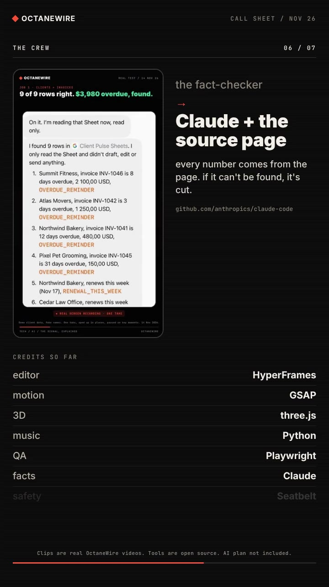

# The zero-person video studio: the free stack behind 35+ OctaneWire videos

*No editor, no motion designer, no composer. Seven free tools, one AI plan, and one rule.*



Every OctaneWire video is made the same way: an AI writes the video as code, free open-source tools render it, and a human checks the last 10%. Here's the crew, what each one does, and how they fit together.

## The crew

| Role | Tool | What it does here | Link |
|---|---|---|---|
| The editor | **HyperFrames** | Each video is an HTML page with one animation timeline. HyperFrames renders it to MP4 at 60fps, frame by frame. | [github.com/heygen-com/hyperframes](https://github.com/heygen-com/hyperframes) |
| The motion designer | **GSAP** | Every slide, stamp, counter and wipe. One paused timeline, so any frame renders the same every time. | [github.com/greensock/GSAP](https://github.com/greensock/GSAP) |
| The 3D artist | **three.js** | The space film: planets, a nebula, an astronaut's helmet, all in a browser. | [github.com/mrdoob/three.js](https://github.com/mrdoob/three.js) |
| The composer | **[phonk.py](tools/phonk.py)** (our script) | Original drift-phonk for every video: kick, sliding 808, cowbell, riser and drop. No copyright strikes. | in this repo |
| The QA team | **Playwright** | Takes snapshots of key frames before rendering, so a broken layout never ships. | [github.com/microsoft/playwright](https://github.com/microsoft/playwright) |
| The fact-checker | **Claude + the source page** | Every number on screen is copied from an official page. If it can't be found there, it's cut. | [github.com/anthropics/claude-code](https://github.com/anthropics/claude-code) |
| The safety guard | **Seatbelt** (ours) | Blocks an AI agent's `rm -rf`, `curl \| bash` and friends before they run. | [github.com/yepishynvladyslav/seatbelt](https://github.com/yepishynvladyslav/seatbelt) |

Plus FFmpeg for compression and swapping audio: [github.com/FFmpeg/FFmpeg](https://github.com/FFmpeg/FFmpeg).

## How a video gets made

1. **Topic.** A fresh story, or a real test we ran ourselves.
2. **Facts.** Claude reads the official pages. Every number and quote on screen comes from them.
3. **Script.** A hook in the first 2 seconds, one idea per scene, a question at the end.
4. **Build.** Claude writes the HTML and GSAP timeline.
5. **Check.** Lint, contrast check, then snapshots of key frames that get looked at before rendering.
6. **Render.** HyperFrames at 60fps, then FFmpeg compresses it for X.
7. **Music.** `phonk.py` writes an original track the exact length of the video.
8. **Article.** A sourced write-up goes into this repo, and the link gets checked.

## The music generator

```bash
pip install numpy
python3 tools/phonk.py track.wav 24 --drop 2.6 --bpm 140 --seed 7
```

- `24` is the length in seconds.
- `--drop` is when the beat hits. Match it to your first cut.
- `--seed` gives you a different track. The same seed always gives the same track.
- `--outro` is the fade-out length at the end. Keep it short (1.5). We once set it to 22 by mistake and the music faded out after 5 seconds.

## The one rule

**The AI does 90%. A human checks the last 10%.** That 10% is where things break: a wrong fade, a quote credited to the wrong source, a notification with a phone number in a screen recording. It's also why people trust what we post.

## What it costs

One AI plan. Every tool in the crew is free and open source. The plan isn't free, so pick the one that matches how much you'll make.

## Your turn

What would you make with this crew? Reply on the [OctaneWire post](https://x.com/OctaneWire).

---

*Written by [OctaneWire](https://x.com/OctaneWire). Tech, AI, markets. The signal, explained.*
